<h1 align="center">UNLOCKING MELBOURNE'S AIRBNB MARKET</h1>

  <strong>CMCE30005 Business Analytics Challenge</strong> 
  Final Project Report  
  <strong>Where Should a Multi-Property Host Invest in Melbourne?</strong>  
  <strong>Group 3</strong> 
  Due Date: 23/10/2026

### Team Members

| Team member | Student ID |
|---|---:|
| Hoang Minh Pham | 1619403 |
| Matthew Le | 1616755 |
| Mayan Sagar Chag | 1658357 |
| Zachary Schkurat | 1625404 |

**GitHub Link:** [github.com/Skraatt/CMCE30005--MyGroupProjectWorkshop1-](https://github.com/Skraatt/CMCE30005--MyGroupProjectWorkshop1-)

---

## Table of Contents

1. [Introduction](#1-introduction)
2. [Problem Definition and Objectives](#2-problem-definition-and-objectives)
   - [Problem Definition](#problem-definition)
   - [Research Question](#research-question)
   - [Objectives](#objectives)
3. [Data Description](#3-data-description)
   - [Exclusions and transformations applied](#exclusions-and-transformations-applied)
   - [Definitions](#definitions)
   - [Data Limitations](#data-limitations)
4. [Methodology and Analytical Approach](#4-methodology-and-analytical-approach)
   - [Method 1: Descriptive screening](#method-1-descriptive-screening)
   - [Method 2: Cross-sectional regression](#method-2-cross-sectional-regression)
   - [Method 3: Predictive benchmarking and market segmentation](#method-3-predictive-benchmarking-and-market-segmentation)
5. [Analysis](#5-analysis)
   - [5.1. Data Exploration and Descriptive Analytics](#51-data-exploration-and-descriptive-analytics)
   - [5.2. Nightly Price Regression](#52-nightly-price-regression)
   - [5.3. Demand Regression](#53-demand-regression)
   - [5.4. Predictive Modelling and Market Segmentation](#54-predictive-modelling-and-market-segmentation)
6. [Key Findings and Recommendations](#6-key-findings-and-recommendations)
   - [6.1. Key Findings](#61-key-findings)
   - [6.2. Recommendations](#62-recommendations)
7. [Limitations and Future Work](#7-limitations-and-future-work)
   - [7.1 Limitations](#71-limitations)
   - [7.2 Future Work](#72-future-work)
8. [References](#8-references)
9. [Appendix A: Regression Results](#appendix-a-regression-results)
10. [Appendix B: Predictive Modelling Results](#appendix-b-predictive-modelling-results)
11. [Appendix C: Key Findings](#appendix-c-key-findings)

## 1. Introduction

Entering Melbourne's short-term rental market requires prospective Airbnb hosts to make two consequential decisions: which submarkets to target and which property configurations to operate. Because property acquisition is capital-intensive and hard to reverse, a poor choice is expensive to correct. Our client plans to list multiple properties in Melbourne and needs evidence on which submarkets and configurations are associated with stronger performance, rather than relying on intuition or agent opinion.

We use the Inside Airbnb Melbourne dataset (Inside Airbnb, 2026), a snapshot from 16 June 2026 covering 25,728 listings across Greater Melbourne. Because it records property characteristics, host attributes, location, review activity and forward availability simultaneously, performance can be examined across all publicly listed Airbnb properties rather than a sampled subset.

We measure performance by nightly price and demand, proxied by recent guest reviews. Using interpretable regression models, a predictive benchmark and market segmentation, this report identifies which property, host and location characteristics are associated with higher prices and demand, and translates these findings into prioritised entry recommendations, with limitations stated explicitly.

## 2. Problem Definition and Objectives

### Problem Definition

A prospective multi-property host entering the Melbourne short-term rental market must decide which submarkets and property types to prioritise. These decisions need to rest on the observable characteristics that drive performance rather than intuition, so that capital is directed towards stronger profiles and away from lower-return submarkets. Submarkets are defined as local government areas (LGAs).

### Research Question

Which property, host and location characteristics are associated with higher nightly prices and stronger demand, and which submarket-property combinations should the client enter first?

### Objectives

The analysis has five objectives:

1. model the drivers of nightly price;
2. model demand for listings using recent guest reviews as a proxy;
3. benchmark the explanatory model against a predictive model to test how well listing characteristics forecast guest activity;
4. compare LGA x property type x guest capacity segments on both measures;
5. translate the results into a prioritised entry plan, including what to verify before purchase.

## 3. Data Description

The data comes from Inside Airbnb (2026) and captures Greater Melbourne on 16 June 2026. Three datasets were utilised:

- **Listings:** 25,728 listings from 14,113 hosts, 90 variables including price and property characteristics; principal modelling dataset
- **Reviews:** 1,026,690 reviews dating back to 2010; principal demand proxies
- **Calendar:** 9.39 million daily rows over 365 forward days

### Exclusions and transformations applied

Thirteen entirely empty variables, plus zero-variance and duplicate fields, were removed. Listings without a price (6,553) and 19 with missing bathroom data were excluded from the price model. The demand model does not need price, so it excludes only 23 listings with missing bathrooms. Price was parsed from a currency string and capped at the 1st and 99th percentiles ($46 and $1,590), affecting 384 listings. The 82 property types were consolidated into seven categories, and coordinates were converted into CBD distance. Recent Reviews was log transformed using log (1 + reviews) for interpretation purposes and to retain inactive listings whilst reducing outlier influence.

**Final dataset dimensions:** The price model uses 19,156 listings and the demand model 25,705 listings

### Definitions

- **Demand:** Recent reviews in the last 12 months transformed by log(1+reviews) as the most suitable proxy
- **Superhost status:** Airbnb's performance-based badge for ratings, responsiveness and reliability (Airbnb, n.d.), recorded as yes/no.
- **Host scale:** portfolio size, single-listing (reference), small (2-5), medium (6-20) or large (21+).
- **Property Profile:** Listing type (House, Apartment etc.) x Guest Capacity (1-2, 3-4 etc.)
- **Market Segment:** Property Profile x LGA

### Data Limitations

- **Missing prices are not random:** 6,553 (25.5%) of listings have no price, and missingness is far higher among non-superhosts (33.4%) than superhosts (7.4%). Price results therefore describe listings that display a price and may understate weaker listings.
- **Calendar availability is not a reliable demand measure:** The Calendar records whether each date is open for booking, but not why a date is closed. The share of the next 90 days does not open for booking was considered as a demand proxy but rejected, for these reasons:

  1. A closed date may be booked or blocked by the host; the calendar does not record which.
  2. It moves in the opposite direction to completed stays. Single-Listing hosts have more unavailable dates than large operators (53.0% vs 32.7%) but fewer reviews (7.4 vs 11.8 a year), so the two measures cannot both be capturing demand.

## 4. Methodology and Analytical Approach

We use three methods, each answering a different question: where price and demand stand out, which characteristics stay associated with them after controls, and which entry segments combine both.

### Method 1: Descriptive screening

Summary statistics (central tendency and dispersion) for price, recent reviews, bedrooms, guest capacity, amenities and CBD distance identify the submarkets and property profiles worth modelling. Reviews in the last 12 months measure realised guest activity, since reviews follow completed stays. Results are grouped by LGA and by property profile, defined as property type × guest capacity (1-2, 3-4, 5-6 or 7+ guests). LGAs with fewer than 50 listings and profiles with fewer than 20 are excluded to avoid unstable small samples. This stage identifies patterns rather than causal effects.

### Method 2: Cross-sectional regression

Two OLS models estimate adjusted associations. The price model uses log total nightly price as the outcome. Total price is what a guest pays, and a host earns per night, so it links directly to revenue, and the log reduces the skew so that coefficients read as percentage differences, (e^β - 1) × 100. Price per guest is used only descriptively, as it is mechanically tied to capacity, a predictor. The demand model uses log(1 + reviews in the last 12 months) as a proxy for guest activity, not occupancy, with coefficients interpreted as percentage changes in (1 + reviews).

Both models share: property type, guest capacity, bedrooms, bathrooms, amenity count, superhost status, host scale, review score, CBD distance and LGA. The price model additionally includes superhost status, review score and a has-reviews indicator. The guest-activity model excludes these review-linked measures to reduce circularity and instead includes log minimum nights. LGA enters as indicator variables to absorb systematic geographic differences, while CBD distance captures proximity effects within them. The reference categories are entire apartment, single-listing host and Bayside, so every coefficient is relative to these. Bayside is a high-priced LGA with weaker review activity, so most LGA coefficients appear as discounts relative to it. Missing review scores for unreviewed listings were mean imputed with a has reviews indicator, and coastal distance was dropped because of its 0.954 correlation with CBD distance.

### Method 3: Predictive benchmarking and market segmentation

OLS was benchmarked against Random Forest using an 80/20 host-level train-test split, preventing listings from the same host appearing in both samples. Predictive performance was compared using test RMSE and R². The better-performing model was then refitted using the available training data and used to estimate performance across eligible listings. Market-entry segments were defined as LGA × property type × guest capacity combinations with at least 20 listings and 20 observed prices. Segments were compared only against equivalent property-type and capacity profiles in other LGAs and ranked on equally weighted price and guest-activity percentiles.

## 5. Analysis

### 5.1. Data Exploration and Descriptive Analytics

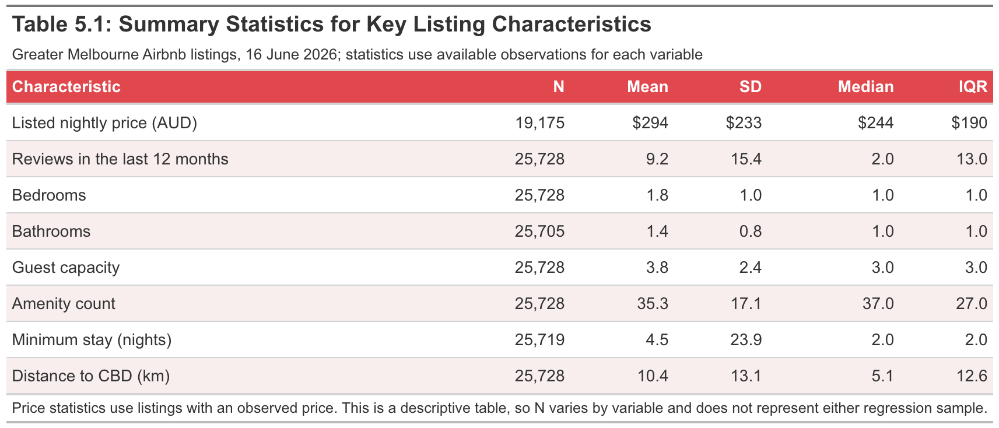

<em>Table 5.1. Melbourne Airbnb market: summary statistics.</em>

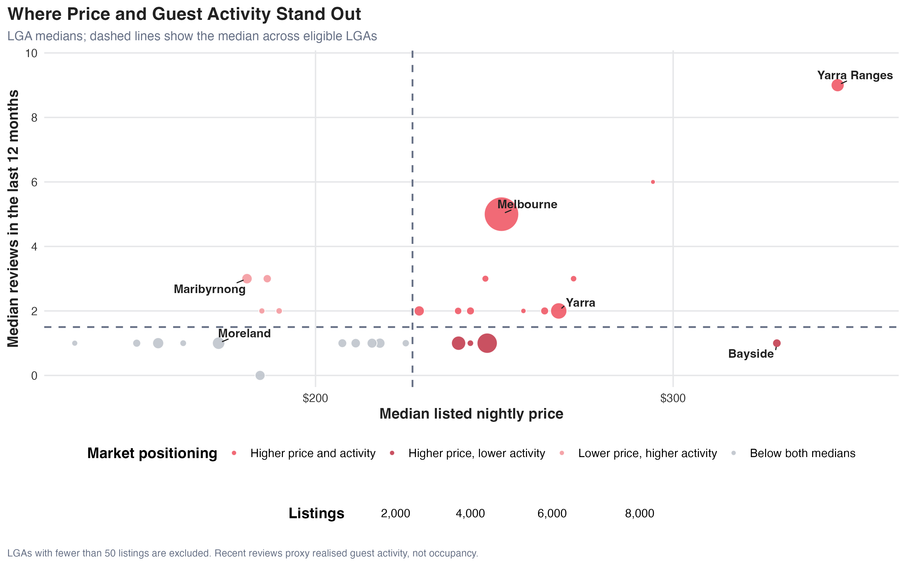

<em>Figure 5.1. LGAs for deeper investigation.</em>

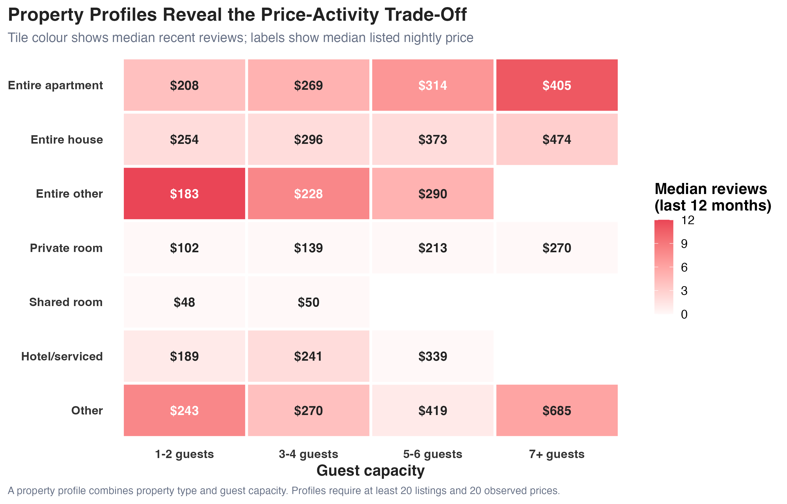

<em>Figure 5.2. Property profiles for deeper investigation.</em>

Per Table 5.1, listed prices and recent reviews are strongly right skewed. Median nightly price is $244 compared with a mean of $294, while the median listing received two reviews compared with a mean of 9.2. This thus informs the usage of logarithmic transformations for these variables in regression analysis for more accurate insights.

LGA comparisons in Figure 5.1 show that pricing power and guest activity do not always move together. Yarra Ranges performs relatively strongly on both measures, whereas Bayside combines higher prices with weaker review activity and Maribyrnong the inverse. This suggests modelling price and guest activity separately as opposed to assuming they are linearly correlated in this dataset.

Property profiles show a similar trade-off. Houses and higher-capacity listings generally attract higher prices, while apartment profiles often record stronger review activity. The subsequent analysis therefore compares locations only within equivalent property-type and capacity groups.

### 5.2. Nightly Price Regression

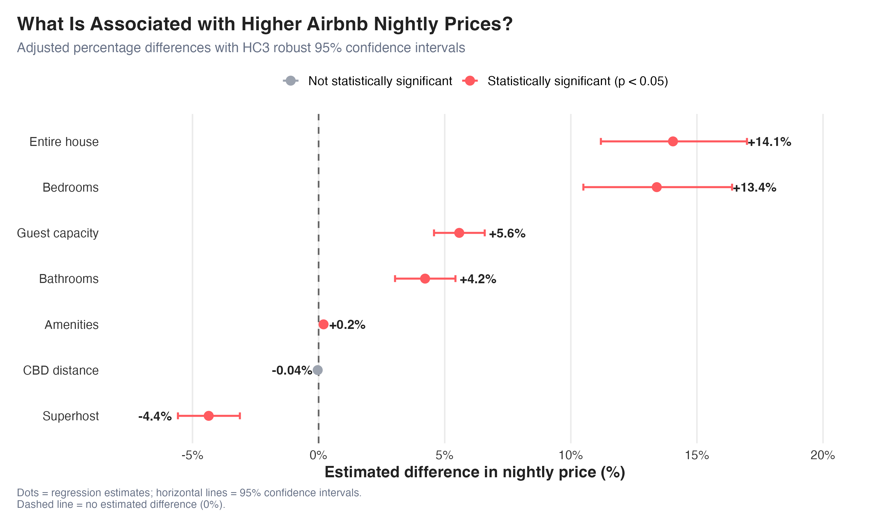

<em>Figure 5.3: Price Regression Coefficient Plot</em>

The price model uses 19,156 listings and explains 60.95% of variation in log nightly price (adjusted R² = 0.6089), with HC3 robust standard errors.

Property configuration is strongly associated with price (Figure 5.3). Relative to entire apartments, entire houses are associated with 14.1% higher prices, while private and shared rooms are 45.0% and 72.4% lower. Each additional bedroom, guest accommodated and bathroom is associated with 13.4%, 5.6% and 4.2% higher prices, respectively.

Superhost status is associated with 4.4% lower adjusted prices. Melbourne is 10.8% lower than comparable Bayside listings, while CBD distance is insignificant (p = 0.498), indicating that location effects are better captured by LGA than proximity alone. Full results are reported in Appendix A.

### 5.3. Demand Regression

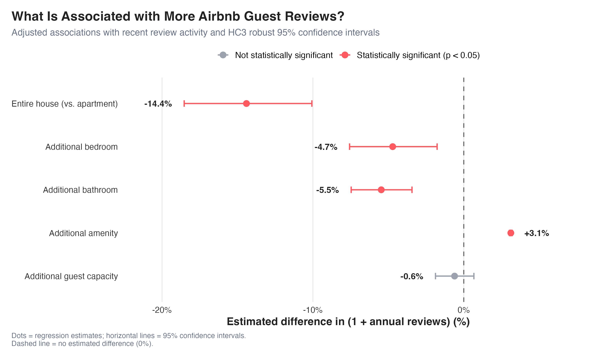

<em>Figure 5.4: Demand Regression Coefficient Plot</em>

The guest-activity model uses 25,705 listings and explains 29.9% of variation in log(1 + reviews in the last 12 months).

Price-enhancing characteristics do not necessarily increase guest activity (Figure 5.4). Entire houses are associated with 14.4% fewer reviews than apartments, while additional bedrooms and bathrooms are associated with 4.7% and 5.5% lower activity. In contrast, each additional amenity is associated with 3.1% higher activity. Guest capacity is insignificant, while longer minimum stays are negatively associated with reviews.

These contrasting effects reinforce the need to assess price and guest activity jointly rather than treating either as a complete measure of market attractiveness. Full results are reported in Appendix A.

### 5.4. Predictive Modelling and Market Segmentation

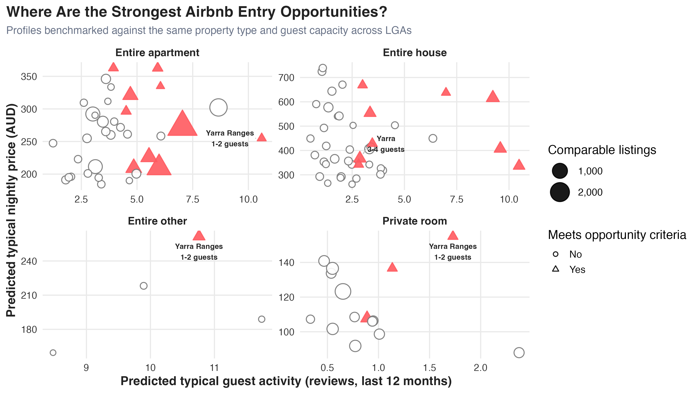

<em>Figure 5.5: Predicted price and guest activity by segment (Predictive model)</em>

Using an 80/20 host-level train-test split, Random Forest modestly outperformed OLS for guest-activity prediction, with lower RMSE (1.1308 vs 1.1470) and higher test R² (0.2880 vs 0.2675).

Figure 5.5 benchmarks LGA segments against equivalent property-type and guest-capacity profiles. Yarra Ranges repeatedly appears among qualifying segments, while entire houses achieve high predicted prices without consistently stronger guest activity. Several apartment segments provide a more balanced price-activity profile.

The results therefore identify relative market opportunities rather than guaranteed occupancy, revenue or profitability. Full rankings and model comparisons are reported in Appendix B.

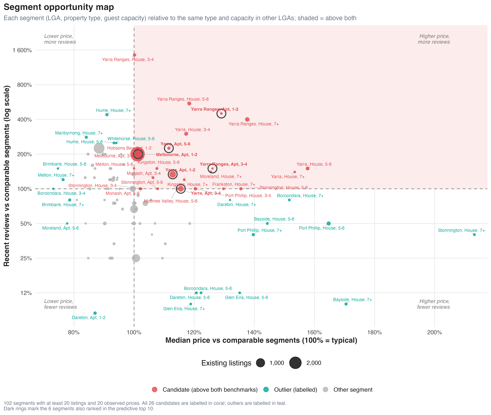

<em>Figure 5.6. Observed segment screen: price and reviews relative to the benchmark</em>

## 6. Key Findings and Recommendations

### 6.1. Key Findings

#### Finding 1: Larger properties command higher prices but record weaker guest activity

Larger properties exhibit a clear trade-off. Entire houses command 14.1% higher prices than apartments but record 14.4% fewer reviews; additional bedrooms similarly increase price by 13.4% while reducing review activity by 4.7% (Figures 5.3-5.4). Price per guest also falls as capacity increases (Figure 6.1). Amenities are the exception, being associated with both slightly higher prices (+0.2%) and stronger guest activity (+3.1%), although this relationship may not be causal.

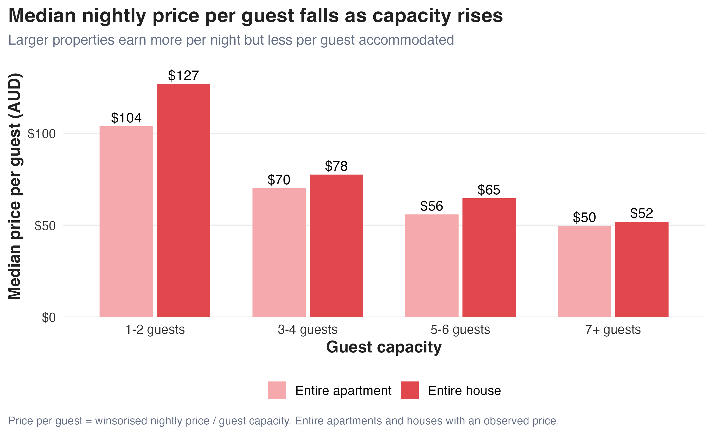

<em>Figure 6.1. Median nightly price per guest-by-guest capacity</em>

#### Finding 2: Superhost status does not confer an adjusted price premium, while larger operators attract more guest activity

Superhost status is associated with 4.4% lower adjusted prices and is excluded from the demand model because qualification depends partly on completed stays. Relative to large operators, single-listing hosts charge 5.9% more but record 22.6% fewer reviews, while small hosts charge 5.7% more but record 11.5% fewer. Longer minimum stays are also associated with fewer reviews. Together, these results suggest that a multi-property entrant should prioritise competitive pricing and booking flexibility rather than relying on a superhost premium.

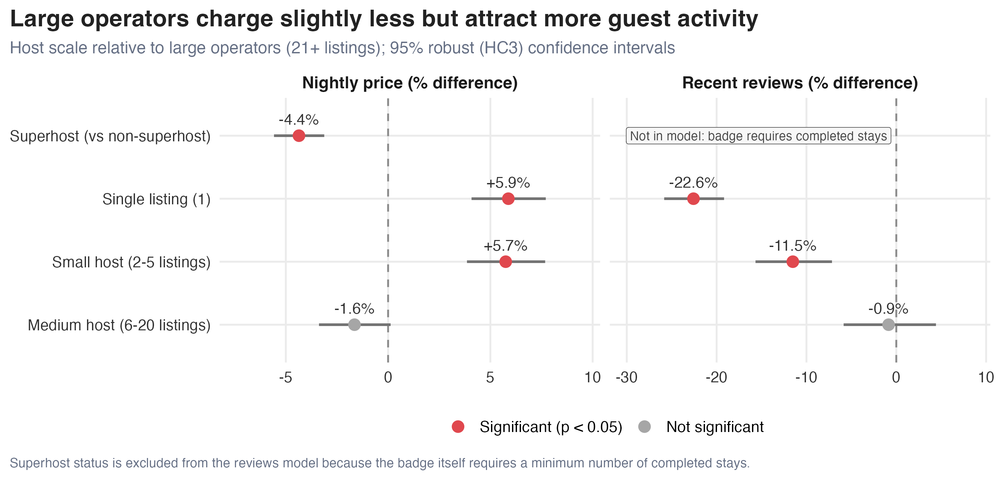

<em>Figure 6.2. Superhost status and host scale: associations with price and demand</em>

#### Finding 3: LGA matters more than linear CBD distance

After controlling for property characteristics and LGA, CBD distance has no significant association with either price or guest activity. In contrast, substantial LGA differences remain. Yarra Ranges and Yarra have prices statistically similar to Bayside but 77.7% and 42.0% more reviews, respectively. Melbourne and Maribyrnong achieve stronger activity at lower prices. The non-linear raw distance pattern in Figure 6.3 further shows why CBD distance alone is insufficient for market selection.

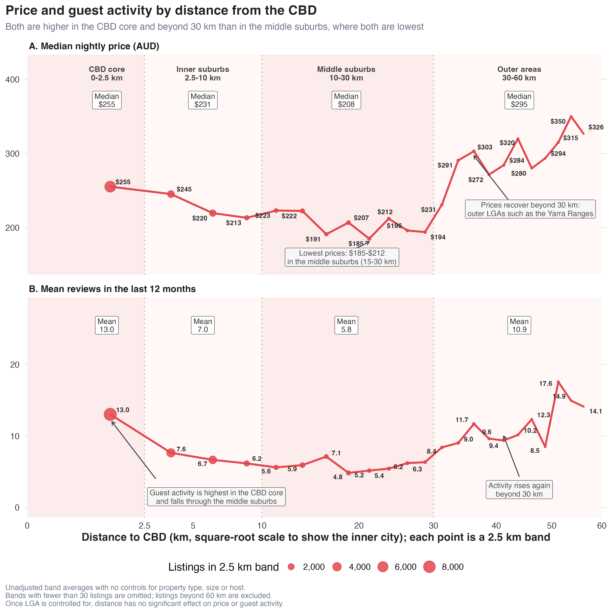

<em>Figure 6.3. Price and demand by distance from the CBD</em>

#### Finding 4: Yarra and Yarra Ranges apartment segments provide the strongest entry candidates

Five apartment segments rank highly under both the observed segment screen and predictive model (Figure 6.5). Yarra Ranges 1-2 guest apartments show the largest relative advantage ($263 vs $204 benchmark; 13.5 vs 3.0 reviews) and score 100.0 predictively, but comprise only 36 listings. Yarra 5-6 guest apartments provide a stronger balance of performance and evidence: $392 versus $351, 9.0 versus 4.0 reviews, a 95.0 predictive score and 71 listings. Larger Yarra apartment segments provide greater market depth but smaller benchmark advantages.

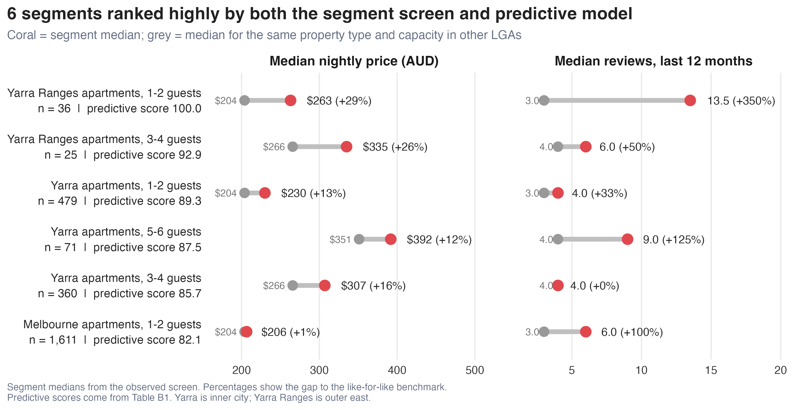

<em>Figure 6.4. Five apartment segments supported by both analytical methods</em>

### 6.2. Recommendations

Based on these findings, we recommend that the client take the following actions. Recommendations 1-3 address what and where to acquire; 4-5 address how to evaluate performance.

| # | Recommendation | Evidence | Risk to manage |
|---:|---|---|---|
| 1 | Target entire apartments in Yarra (1-6 guests) and the Yarra Ranges (1-4 guests) | These are the only five segments ranked highly by both the segment screen and the predictive model, and each is at or above its benchmark on price and reviews (Figure 6.5, Appendix Table B1). Both LGAs show no significant price difference from Bayside but receive 42.0% and 77.7% more reviews (Finding 3). | The Yarra Ranges segments are small (36 and 25 listings), so their medians are less certain. |
| 2 | Make Yarra apartments for 5-6 guests the first purchase | Above benchmark on price (+12%) and reviews (+125%), with a predictive score of 95.0 and more listings (71) than the top-scoring Yarra Ranges segment (36) (Figure 6.5). | 71 listings is still a modest sample, so check local performance before entering. |
| 3 | Equip each property with a full set of amenities | Amenities are the only listing feature associated with both higher price (+0.2%) and more reviews (+3.1%) for each additional amenity (Finding 1). | This link may partly reflect more active hosts listing more amenities, rather than amenities driving demand. |
| 4 | Professional host portfolio: Price competitively, keep minimum stays short and no premium for superhost status | Single-listing hosts charge 5.9% more than large operators but receive 22.6% fewer reviews. A two-night rather than one-night minimum is linked to 23.5% fewer reviews, and superhost listings show no listed price premium (-4.4%) (Finding 2). | Lower nightly prices often cut revenue per night, so the extra bookings need to outperform. |
| 5 | Verify occupancy and costs before purchase, using paid booking data or local property managers | Reviews record completed stays and not the nights booked, and purchase and running costs are not in the data (section 3). | Committing capital on estimates the data cannot confirm. |

<em>Table 6.2. Recommendations</em>

## 7. Limitations and Future Work

### 7.1 Limitations

The data limitations outlined in Section 3, including non-random missing prices, derived performance fields, and an unreliable calendar measure, are also relevant in this context. In addition to these, five further limitations constrain the reliability of the findings.

**Associations, not causes:** Each listing is observed once, so the regression results show associations. Listings with an extra bedroom charge 13.4% more on average, but adding a bedroom to a property would not necessarily raise its price by that amount. The same applies to amenities: listings with more amenities receive more reviews, but active hosts may simply list more amenities.

**Reviews serve as a proxy for completed stays rather than nights booked.** Each review corresponds to one completed stay, regardless of its duration or group size, and not all guests leave reviews. Consequently, recent reviews reflect relative guest activity rather than actual occupancy or revenue.

**A significant portion of the variation remains unexplained.** The price model accounts for 61% of the variation in price, whereas the demand model explains only 30% of the variation in reviews (R² = 0.30). Out-of-sample, the Ordinary Least Squares and Random Forest models explain 27% and 29% of the variation in guest activity, respectively (Appendix Table B2). Factors not captured in the data, such as listing photos, interior quality, and pricing strategy, are likely to influence outcomes.

**The analysis is based on a single data snapshot from 16 June 2026,** and the calendar file lacks price information. As a result, seasonal differences in price or demand cannot be evaluated accurately.

**Small segments and method sensitivity.** Two of the five recommended segments are small: the Yarra Ranges apartments for 1-2 and 3-4 guests have only 36 and 25 listings. The segment screen and the predictive model also agree on only five segments, so the ranking depends partly on the method used. Purchase and running costs are not in the data either, so the findings indicate revenue potential, not profitability.

### 7.2 Future Work

Each limitation points to next steps:

- **Conducting the analysis across multiple Inside Airbnb snapshots would enable tracking of the same listings over time:** This approach would capture seasonal variation and facilitate the use of panel models, which are better suited to identifying causal effects than a single cross-sectional analysis.
- **Replacing the review proxy with actual booking data,** such as commercial booking records or data from local property managers, would provide direct measures of nights booked and revenue. This would enable more accurate occupancy-based revenue estimates.
- **Procure feasible cost data:** Combining revenue estimates with property prices and running costs for each LGA would show which segments are most profitable, not just which earn more per night.
- **Use the text fields already in the data:** The listings file includes a written description for each listing, and the reviews file includes guest comments. Text analysis could capture quality factors that the current models miss and may explain more of the variation in demand.

## 8. References

Airbnb. (n.d.). *What's required to be a Superhost*. Airbnb Help Centre. Retrieved October 23, 2026, from <https://www.airbnb.com/help/article/829>

Inside Airbnb. (2026). *Melbourne, Victoria, Australia: 16 June 2026* [Data set]. <https://insideairbnb.com/get-the-data/>

## Appendix A: Regression Results

Both models are estimated by OLS with HC3 heteroskedasticity-robust standard errors. Reference categories: entire apartment (property type), single-listing host (host scale) and Bayside (LGA). Significance: *** p < 0.001, ** p < 0.01, * p < 0.05, . p < 0.1.

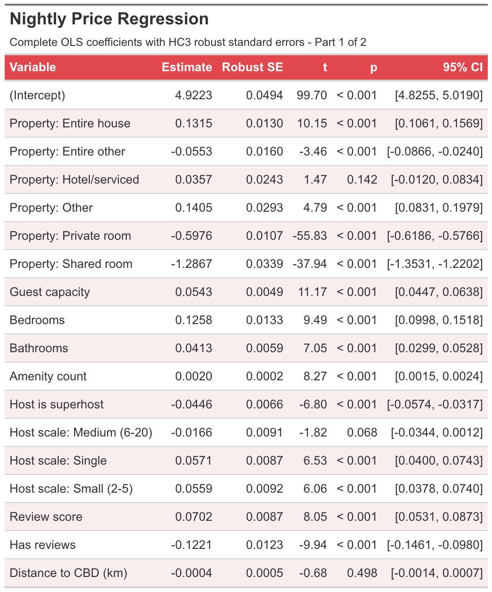

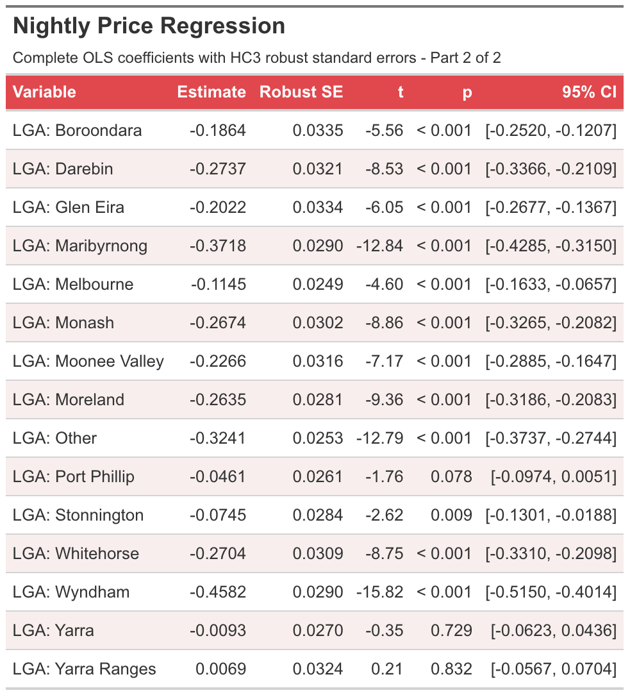

<em>Table A1. Price model: dependent variable = log(nightly price)</em>

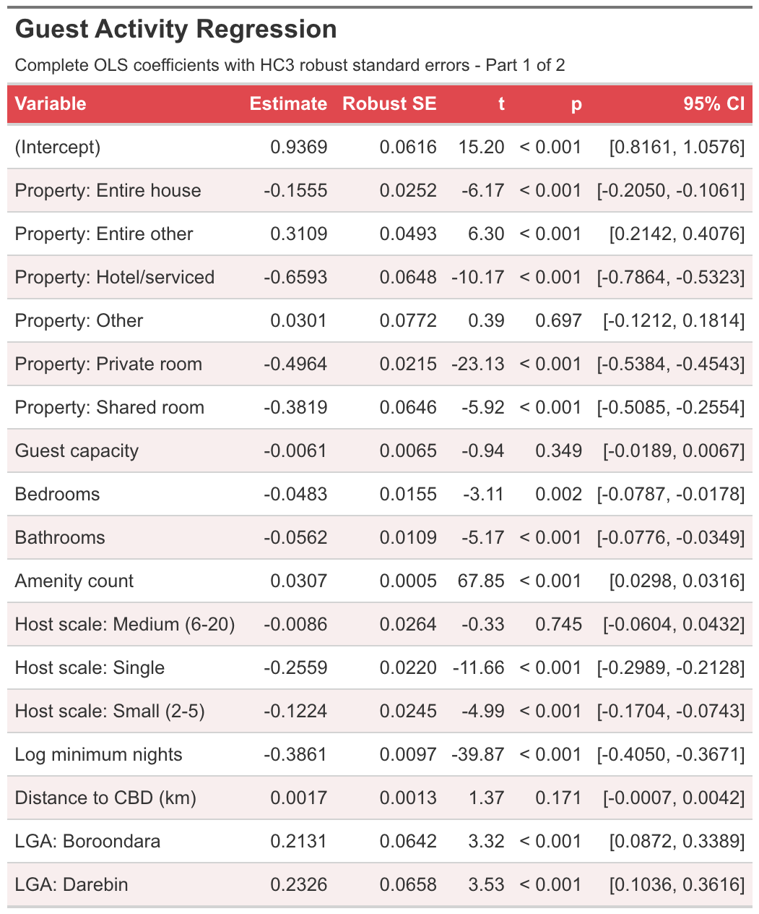

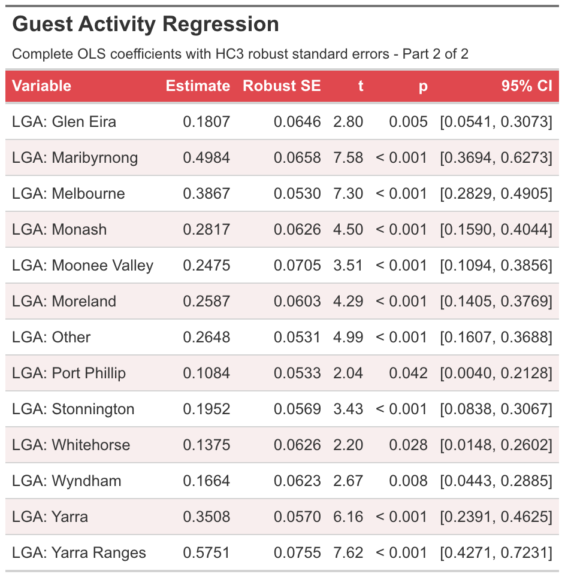

<em>Table A2. Demand model: dependent variable = recent guest reviews</em>

## Appendix B: Predictive Modelling Results

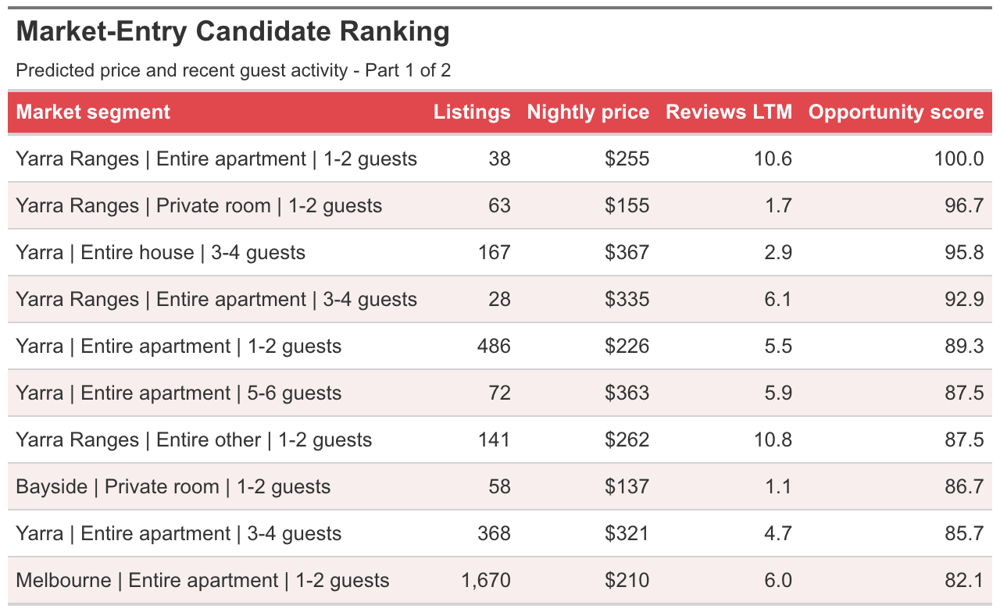

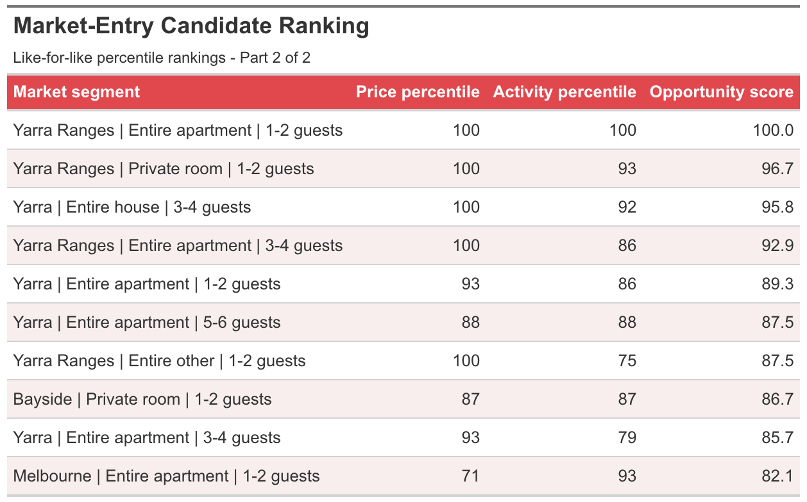

<em>Table B1. Top 10 market-entry candidate</em>

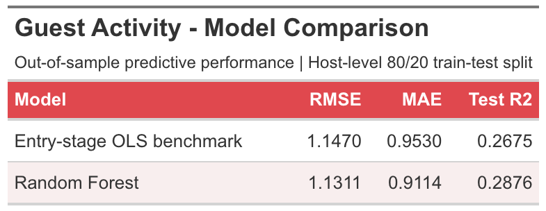

<em>Table B2. Model comparison output</em>

## Appendix C: Key Findings

| LGA | Type | Guests | Listings | Price | Price bench. | Price gap | Reviews | Reviews bench. | Reviews gap | Both methods |
|---|---|---:|---:|---:|---:|---:|---:|---:|---:|---|
| Yarra Ranges | Apt | 1-2 | 36 | $263 | $204 | +29.0% | 13.5 | 3.0 | +350.0% | Yes |
| Melbourne | Apt | 1-2 | 1,611 | $206 | $204 | +1.3% | 6.0 | 3.0 | +100.0% |  |
| Hobsons Bay | Apt | 1-2 | 27 | $205 | $204 | +0.8% | 6.0 | 3.0 | +100.0% |  |
| Yarra | Apt | 1-2 | 479 | $230 | $204 | +12.9% | 4.0 | 3.0 | +33.3% | Yes |
| Melbourne | Apt | 3-4 | 2,790 | $269 | $266 | +1.2% | 8.0 | 4.0 | +100.0% |  |
| Yarra Ranges | Apt | 3-4 | 25 | $335 | $266 | +26.1% | 6.0 | 4.0 | +50.0% | Yes |
| Monash | Apt | 3-4 | 56 | $282 | $266 | +6.3% | 5.0 | 4.0 | +25.0% |  |
| Yarra | Apt | 3-4 | 360 | $307 | $266 | +15.5% | 4.0 | 4.0 | 0.0% | Yes |
| Yarra | Apt | 5-6 | 71 | $392 | $351 | +11.6% | 9.0 | 4.0 | +125.0% | Yes |
| Monash | Apt | 5-6 | 33 | $360 | $351 | +2.4% | 4.0 | 4.0 | 0.0% |  |
| Stonnington | Apt | 5-6 | 53 | $379 | $351 | +7.8% | 4.0 | 4.0 | 0.0% |  |
| Yarra Ranges | House | 3-4 | 82 | $324 | $324 | +0.2% | 14.5 | 1.0 | +1350.0% |  |
| Yarra | House | 3-4 | 129 | $380 | $324 | +17.3% | 3.0 | 1.0 | +200.0% |  |
| Stonnington | House | 3-4 | 62 | $330 | $324 | +2.0% | 1.0 | 1.0 | 0.0% |  |
| Port Phillip | House | 3-4 | 93 | $390 | $324 | +20.4% | 1.0 | 1.0 | 0.0% |  |
| Yarra Ranges | House | 5-6 | 132 | $406 | $343 | +18.4% | 11.0 | 2.0 | +450.0% |  |
| Melton | House | 5-6 | 31 | $343 | $343 | 0.0% | 3.0 | 2.0 | +50.0% |  |
| Yarra | House | 5-6 | 119 | $541 | $343 | +57.7% | 3.0 | 2.0 | +50.0% |  |
| Kingston | House | 5-6 | 58 | $369 | $343 | +7.6% | 3.0 | 2.0 | +50.0% |  |
| Stonnington | House | 5-6 | 75 | $465 | $343 | +35.5% | 2.0 | 2.0 | 0.0% |  |
| Moonee Valley | House | 5-6 | 36 | $392 | $343 | +14.3% | 2.0 | 2.0 | 0.0% |  |
| Yarra Ranges | House | 7+ | 184 | $624 | $453 | +37.7% | 10.0 | 2.5 | +300.0% |  |
| Moreland | House | 7+ | 42 | $569 | $453 | +25.5% | 3.5 | 2.5 | +40.0% |  |
| Yarra | House | 7+ | 40 | $695 | $453 | +53.4% | 3.5 | 2.5 | +40.0% |  |
| Kingston | House | 7+ | 47 | $529 | $453 | +16.7% | 3.0 | 2.5 | +20.0% |  |
| Frankston | House | 7+ | 50 | $588 | $453 | +29.7% | 2.5 | 2.5 | 0.0% |  |

<em>Table C1. Figure 5.4: the 26 candidate segments among 102 screened segments. Segments need at least 20 listings and 20 observed prices, with the same property type and capacity in at least 3 LGAs. Benchmark = median of the same type and capacity across LGAs; prices are medians of listed prices. 'Both methods' marks segments also ranked highly in Appendix Table B1.</em>

| Guest capacity | Apartment: price per guest | Apartment: listings | House: price per guest | House: listings |
|---|---:|---:|---:|---:|
| 1-2 guests | $104 | 2,963 | $127 | 293 |
| 3-4 guests | $70 | 4,152 | $78 | 819 |
| 5-6 guests | $56 | 1,792 | $65 | 1,346 |
| 7+ guests | $50 | 529 | $52 | 1,555 |

<em>Table C2. Figure 6.1: median nightly price per guest (winsorised price ÷ guest capacity).</em>

| Variable | Price % | Price 95% CI | Price p | Reviews % | Reviews 95% CI | Reviews p |
|---|---:|---:|---:|---:|---:|---:|
| Superhost (vs non-superhost) | -4.4% | [-5.6%, -3.1%] | < 0.001 | Not in model |  |  |
| Single listing (1) | +5.9% | [+4.1%, +7.7%] | < 0.001 | -22.6% | [-25.8%, -19.2%] | < 0.001 |
| Small host (2-5 listings) | +5.7% | [+3.9%, +7.7%] | < 0.001 | -11.5% | [-15.7%, -7.2%] | < 0.001 |
| Medium host (6-20 listings) | -1.6% | [-3.4%, +0.1%] | 0.068 | -0.9% | [-5.9%, +4.4%] | 0.745 |

<em>Table C3. Figure 6.2: superhost status and host scale. Host scale is relative to large operators (21+ listings). Superhost status is not in the guest-activity model.</em>

| LGA | Price vs Bayside | Price: p | Reviews vs Bayside | Reviews: p |
|---|---:|---:|---:|---:|
| Yarra Ranges | +0.7% | 0.832 | +77.7% | < 0.001 |
| Maribyrnong | -31.0% | < 0.001 | +64.6% | < 0.001 |
| Melbourne | -10.8% | < 0.001 | +47.2% | < 0.001 |
| Yarra | -0.9% | 0.729 | +42.0% | < 0.001 |
| Monash | -23.5% | < 0.001 | +32.5% | < 0.001 |
| Other | -27.7% | < 0.001 | +30.3% | < 0.001 |
| Moreland | -23.2% | < 0.001 | +29.5% | < 0.001 |
| Moonee Valley | -20.3% | < 0.001 | +28.1% | < 0.001 |
| Darebin | -23.9% | < 0.001 | +26.2% | < 0.001 |
| Boroondara | -17.0% | < 0.001 | +23.7% | < 0.001 |
| Stonnington | -7.2% | 0.009 | +21.6% | < 0.001 |
| Glen Eira | -18.3% | < 0.001 | +19.8% | 0.005 |
| Wyndham | -36.8% | < 0.001 | +18.1% | 0.008 |
| Whitehorse | -23.7% | < 0.001 | +14.7% | 0.028 |
| Port Phillip | -4.5% | 0.078 | +11.5% | 0.042 |

<em>Table C4. Figure 6.3: LGA effects relative to Bayside.</em>

| Zone | Listings | Listings with price | Median price | Mean reviews (12 months) |
|---|---:|---:|---:|---:|
| CBD core 0-2.5 km | 8,790 | 6,827 | $255 | 13.0 |
| Inner suburbs 2.5-10 km | 8,772 | 5,756 | $231 | 7.0 |
| Middle suburbs 10-30 km | 5,692 | 4,418 | $208 | 5.8 |
| Outer areas 30-60 km | 2,220 | 1,931 | $295 | 10.9 |

<em>Table C5a. Figure 6.4: price and guest activity by distance zone. Price statistics use listings with an observed price.</em>

| Band (km) | Listings | Listings with price | Median price | Mean reviews (12 months) |
|---|---:|---:|---:|---:|
| 0.0-2.5 | 8,790 | 6,827 | $255 | 13.0 |
| 2.5-5.0 | 3,932 | 2,514 | $245 | 7.6 |
| 5.0-7.5 | 3,351 | 2,225 | $220 | 6.7 |
| 7.5-10.0 | 1,489 | 1,017 | $213 | 6.2 |
| 10.0-12.5 | 953 | 724 | $223 | 5.6 |
| 12.5-15.0 | 1,160 | 877 | $222 | 5.9 |
| 15.0-17.5 | 767 | 576 | $191 | 7.1 |
| 17.5-20.0 | 915 | 716 | $207 | 4.8 |
| 20.0-22.5 | 626 | 511 | $185 | 5.2 |
| 22.5-25.0 | 473 | 377 | $212 | 5.4 |
| 25.0-27.5 | 437 | 343 | $196 | 6.2 |
| 27.5-30.0 | 361 | 294 | $194 | 6.3 |
| 30.0-32.5 | 287 | 247 | $231 | 8.4 |
| 32.5-35.0 | 325 | 278 | $291 | 9.0 |
| 35.0-37.5 | 367 | 313 | $303 | 11.7 |
| 37.5-40.0 | 223 | 189 | $272 | 9.6 |
| 40.0-42.5 | 237 | 204 | $284 | 9.4 |
| 42.5-45.0 | 152 | 131 | $320 | 10.2 |
| 45.0-47.5 | 124 | 113 | $280 | 12.3 |
| 47.5-50.0 | 124 | 111 | $294 | 8.5 |
| 50.0-52.5 | 199 | 187 | $315 | 17.6 |
| 52.5-55.0 | 131 | 114 | $350 | 14.9 |
| 55.0-57.5 | 36 | 32 | $326 | 14.1 |

<em>Table C5b. Figure 6.4: values for each 2.5 km band plotted. Bands with fewer than 30 listings are omitted.</em>

| LGA | Guests | Listings | Price | Price bench. | Price gap | Reviews | Reviews bench. | Reviews gap | Score (B1) |
|---|---:|---:|---:|---:|---:|---:|---:|---:|---:|
| Yarra Ranges | 1-2 | 36 | $263 | $204 | +29.0% | 13.5 | 3.0 | +350.0% | 100.0 |
| Yarra | 5-6 | 71 | $392 | $351 | +11.6% | 9.0 | 4.0 | +125.0% | 95.0 |
| Yarra Ranges | 3-4 | 25 | $335 | $266 | +26.1% | 6.0 | 4.0 | +50.0% | 92.9 |
| Yarra | 1-2 | 479 | $230 | $204 | +12.9% | 4.0 | 3.0 | +33.3% | 89.3 |
| Yarra | 3-4 | 360 | $307 | $266 | +15.5% | 4.0 | 4.0 | 0.0% | 85.7 |

<em>Table C6. Figure 6.5: the five segments ranked highly by both the segment screen and the predictive model. Scores are from Appendix Table B1.</em>

